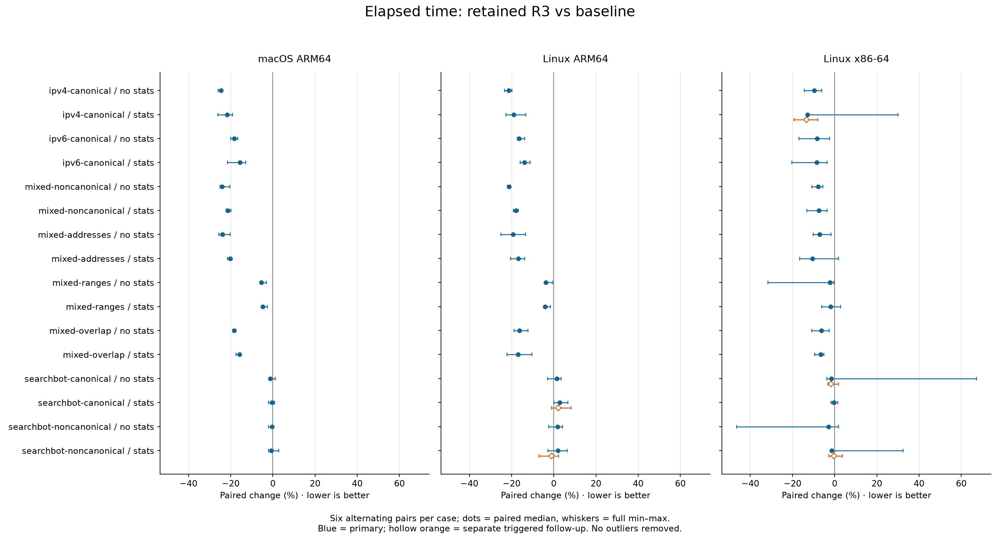
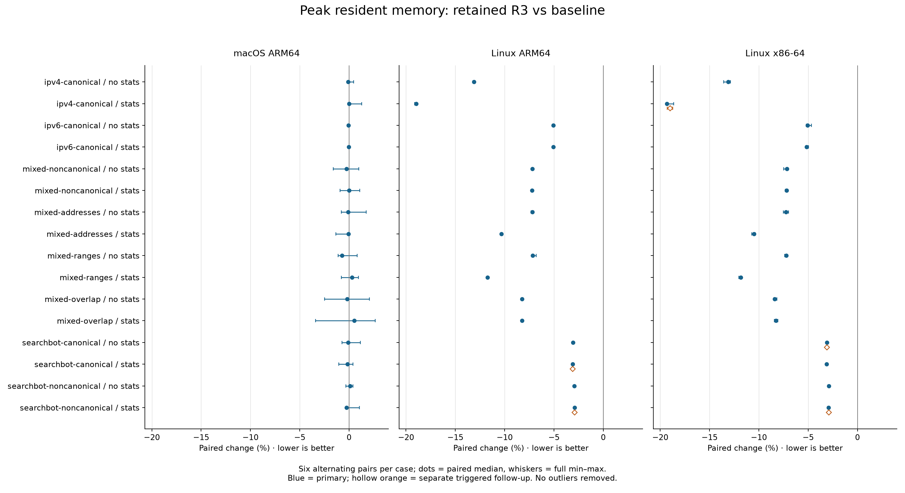

# FoundationEssentials and Swift System prototype

Baseline: `9fe30dde3fd5ad50944064f912fad8c19cfcec62`. Prototype branch: `perf/essentials-system-io`.
Experiment: `cidrmerge-essentials-system-20261117T053919Z`, preserved under `$HOME/Downloads` on the Mac and swift-dev.

**Complete prototype: R3 retained; S2 rejected. All requested platform suites and matched measurement phases are preserved and audited.**

The retained prototype uses FoundationEssentials on Linux, Swift System file descriptors, and one reusable 64-KiB read buffer per input source. It preserves the existing pending-line array and whole-document/whole-output `Data` contracts. A separate borrowed-line implementation was tested and rejected after repeatable throughput regressions on all three architectures. Its sources, binaries, observations, and failed controls remain preserved.

This is an uncommitted experiment, not a release. The eight locked dependency revisions and Swift 6.2 compiler floor are unchanged. Swift System 1.7.4 was already resolved through swift-cidr's CIDRNIO dependency graph; this prototype makes its `SystemPackage` product a direct dependency of CIDRMergeCLI. CIDRMergeCore remains independent of Foundation, Crypto, and SystemPackage.

## What changed and what was isolated

| Variant | Change relative to previous variant | Status |
|---|---|---|
| B | Frozen current main | Baseline |
| E4 | Essentials imports, System descriptors, compatible trimming/percentage/error helpers; owned `Data` per descriptor read and original pending-line loop | Migration control |
| R3 | Reuse one raw 64-KiB read allocation; retain pending-line accumulation | Retained prototype |
| S2 | Borrow complete lines directly from read storage; carry only split lines | Rejected negative experiment |

E4-to-R3 changes only DescriptorIO, TextInput, and the descriptor tests. R3-to-S2 changes only TextInput and its read-buffer tests. Frozen patches and manifests establish those boundaries. The final direct B-to-R3 comparison was added after S2 was rejected; stage percentages are not multiplied or substituted for that direct comparison.

The CLI continues to use `Data`, `URL`, and `JSONDecoder`. Named Searchbot files still use `Data(contentsOf:)`; redirected Searchbot stdin exercises the new descriptor reader. Output remains a complete `Data` value, and atomic file output, checksum publication, MergeResult, parser selection, coalescing, and normalization-statistics behavior are unchanged.

## Results

The following ranges span the per-case paired medians, not the individual sample spread. Each primary case has six alternating pairs; the linked detailed tables and charts retain all spreads and separate follow-ups. Negative means lower elapsed time or RSS.

| Platform | Text elapsed, 12 configurations | Text peak RSS, 12 configurations | Named-file Searchbot elapsed, 4 configurations |
|---|---:|---:|---:|
| macOS ARM64 | -24.6% to -4.7% | -0.7% to +0.5% | -1.2% to -0.4% |
| Linux ARM64 | -21.4% to -3.7% | -19.0% to -5.1% | +1.5% to +2.8% |
| Linux x86-64 | -12.9% to -1.9% | -19.3% to -5.1% | -3.0% to -0.4% |

The retained text reader improves throughput on the measured million-entry text workloads. The migration alone does not explain those gains: on macOS its text changes are approximately flat, and on x86-64 some migration-only cases regress. Reusing the buffer is separately measured and restores or improves those paths. Searchbot named-file parsing largely bypasses that text loop, so there is no claim of a general JSON parsing improvement.

All twelve text primary medians are lower on each platform. The roughly 2% x86-64 range-input changes are small and noisy, and should remain inconclusive; the clearer gains are on the ordered address/prefix inputs. In the direct retained comparisons there is no repeated >5% elapsed-time or RSS median regression, which does not mean every observation improved. x86-64 retained individual elapsed increases of +30.00%, +67.24%, and +32.39% in the three flagged cases; their separate follow-up medians were −13.44%, −1.69%, and −0.29%. Searchbot changes remain small/noisy. No observations were removed or phases pooled.

The borrowed-line variant S2 is slower than R3 across the measured text cases, with repeated double-digit regressions on several configurations. It does not deliver a useful RSS reduction. Source inspection suggests generic slice indexing and bounds checks may contribute, but this experiment does not prove that attribution with profiling or generated-code analysis. The results reject this implementation; they do not establish that borrowing lines is inherently slower.

See [RETAINED.md](RETAINED.md) for absolute elapsed/RSS medians and the full paired minimum–maximum spread, [REGRESSIONS.md](REGRESSIONS.md) for the >5% observations and follow-up findings, and the companion CSVs for all intermediate variants, CPU observations, and individual pairs.

## Binary size, dependencies, and startup

| Platform | Shipping-style stripped B | Shipping-style stripped R3 | Change |
|---|---:|---:|---:|
| macOS ARM64 | 1,290,512 bytes | 1,515,776 bytes | +17.46% |
| Linux ARM64 | 60,849,832 bytes | 17,260,632 bytes | -71.63% |
| Linux x86-64 | 62,619,384 bytes | 18,837,680 bytes | -69.92% |

See [ARTIFACTS.md](ARTIFACTS.md) for separately stripped ordinary executables, runtime-library accounting, exact identities, and the startup-RSS method control.

Linux ordinary dynamic executables and shipping-style executables are different artifacts. Throughput uses the ordinary Release binary, frozen before test builds. Startup is measured both with separately stripped ordinary copies and with separately rebuilt shipping-style binaries. Linux shipping builds use the existing static-Swift-standard-library release settings. The macOS build uses the release workflow's path remapping and stripping settings. Million-entry throughput gains are qualified to the ordinary Release profile; the static Linux shipping profile has size, linkage, content, and startup checks rather than another million-entry throughput matrix.

Removing full Foundation from the audited Linux ordinary dynamic runtime closure removes FoundationInternationalization/ICU dependencies from those CLI builds. Static shipping artifacts are accounted for separately. Sizes of dependent library files are an accounting of on-disk files, not resident memory or bytes embedded in the executable. The macOS helper deliberately retains Foundation behavior and the executable still links Foundation/CryptoKit; linking portable SystemPackage increases its stripped size. A future experiment could compare the platform SDK's System module, but that was not implemented or measured here.

Startup measurements use warm caches and repeated local execution. They are not cold-launch, network-filesystem, or deployment measurements. Separate unchanged `/bin/true` controls on both Linux hosts confirmed that the Python fork/exec measurement harness establishes a peak-RSS floor for very small processes: increasing only the parent allocation increased the reported child peak. Equal shipping-startup RSS cannot establish equal application-only memory. Original values remain uncorrected; no floor is subtracted. Million-entry measurements are above this floor. On macOS, native CPU accounting has 0.01-second resolution, so CPU percentage changes for tiny calls are not interpreted.

Shipping-profile primary startup medians are 11.6–14.8% lower on ARM64 Linux and 17.8–21.2% lower on x86-64. Mac shipping tiny-call medians are slightly higher, about 1.7–4.2% across primary and follow-up phases (roughly 0.2–0.4 ms absolute differences). Mac ordinary `--version` is +3.68% initially and +5.35% in the follow-up, about 0.35–0.42 ms. The individual startup observations have wide spreads; this prototype does not establish a Mac startup benefit or zero startup regressions.

## Correctness and qualification

| Platform / compiler | B Debug / Release | R3 Debug / Release | R3 CLI differential | R3 expanded I/O differential |
|---|---:|---:|---:|---:|
| macOS ARM64 / 6.4.2 | 85 / 85 | 95 / 95 | 254 cases | 84 cases |
| Linux ARM64 / 6.4.2 | 85 / 85 | 95 / 95 | 254 cases | 86 cases |
| Linux x86-64 / 6.4.2 | 85 / 85 | 95 / 95 | 254 cases | 86 cases |
| Linux ARM64 / 6.2.4 floor | Not repeated in this floor gate | 95 / 95 | Not repeated | Not repeated |

All counts above passed. E4 has 95 tests and S2 has 96 tests in each Swift 6.4.2 Debug/Release platform suite; S2 also has separate 6.2.4 floor evidence. Those variant results remain separate from retained R3.

Full Debug and Release suites were run for frozen baseline and candidates on all three Swift 6.4.2 platforms. Retained R3 also passed Debug and Release on ARM64 Linux with Swift 6.2.4. Qualification includes byte-for-byte differential CLI coverage, exact diagnostics/statistics/checksums, malformed UTF-8 and Unicode boundaries, BOM/CR/chunk boundaries, filesystem failures, descriptor ownership, small reads/EOF, fragmented input, and delayed stdout consumption. Output bytes and stderr are checked against preserved references on every timing observation.

Formatting, content audit, documentation generation, isolated external Core consumer, and CLI smoke checks passed for the retained candidate. The external consumer verifies that neither Crypto nor SystemPackage is compiled into the Core-only graph. Tests use Foundation as an oracle where appropriate; test-binary linkage is not evidence of CLI linkage.

## Compatibility cost and scope

Preserving observable behavior is more work than exchanging imports. The prototype retains strict Foundation UTF-8 initializers available in Essentials, preserves scalar trimming including U+200B, and reproduces the existing percentage formatter's decimal rounding on Linux. A compatibility helper renders the existing Cocoa/POSIX diagnostics and honors tested localized-error overrides. Darwin keeps the original Foundation formatting and diagnostic APIs, including observed directory-open errno behavior.

These helpers add maintenance cost. Linux's generic Error fallback uses underscored `_domain` and `_code` witnesses. Arbitrary custom-domain NSError userInfo is outside Essentials-only introspection; current CLI error sources and explicit tested injections are covered, not every possible Foundation subclass. Diagnostic mappings and decimal-format parity are qualified to the tested toolchains. See [COMPATIBILITY.md](COMPATIBILITY.md) for the exact scope, probes, and retained failed controls.

The reader's scratch storage is bounded and reused, but the longest pending line, parsed ranges, Searchbot document, summarized networks, and complete output `Data` can still scale with input/output size. This experiment does not claim zero allocations, bounded total process memory, or a general Unicode-input speedup.

## Preserved setup and audit recoveries

Earlier compatibility drafts exposed real formatting and diagnostic mismatches; those source snapshots and failed controls were retained and corrected before freezing E4/R3/S2. A Mac startup preflight then found missing stripped aliases before any startup process ran; the fixed run uses a new phase directory. Final-validation whitespace checks were corrected to inspect the source delta rather than misclassify historical patch artifacts as new source.

On ARM64, optional post-phase hardlink deduplication encountered a transient OrbStack file-metadata lookup failure after a complete phase. The files and observations remained intact and were independently verified. ARM-specific wrappers omit that optional cross-phase relinking; the timed runner and exact-output checks are unchanged. On both Linux hosts, auditors initially compared access timestamps before/after reading; reads can legitimately change that timestamp. Separately versioned auditors exclude access time while retaining file identity, size, modification/change times, and mandatory content hashes. Failed audits and negative controls remain preserved; measurements were not rerun or discarded to pass those audits.

swift-dev needed preservation-only hardlink maintenance between complete phases because an extra `stdout.link` alias retained redundant copies. Identical contents were verified before relinking only new experiment files. Paths, measurements, sources, and frozen binaries were preserved. No historical cache directory was deleted. Full platform failure ledgers and receipts are mapped by the exported report indices.

The first swift-dev evidence transfer stopped on intentionally unreadable permission-test fixtures after all timing and remote audits had passed. That partial archive and error were retained. A second transfer preserved the original mode-000 headers while temporarily making only those new test fixtures readable; modes were restored remotely and locally. The completed archive was hash-verified and its benchmark observations were re-audited on the Mac.

The public-report whitespace preflight flagged the CSV writer's CRLF endings and then Matplotlib's SVG path whitespace. Both exports and failed checks were preserved. Public CSV copies use LF, with parsed records verified identical; original CSVs and all measurement values remain unchanged. The repository report uses the identical PNG exports, while original SVGs remain in Downloads. The export manifest records the CSV presentation transformation and local-path redaction separately from original-content hashes.

## Measurement protocol and reproducibility

| Platform | Machine / allocation | OS and toolchain |
|---|---|---|
| macOS ARM64 | Apple M1 Max, 10 cores, 64 GiB | macOS 27.2.1 (26B131), Xcode 27.2 (27B52), Swift 6.4.2 |
| Linux ARM64 | Native ARM64 OrbStack on the same Mac; 10 CPUs visible, approximately 16-GiB VM | Ubuntu 24.04.5, OrbStack kernel 7.2.12, Swift 6.4.2 release toolchain |
| Linux x86-64 | swift-dev, Xeon E5520, four assigned CPUs, 8-GiB memory limit | Ubuntu 24.04.5, Proxmox kernel 6.14.8, Swift 6.4.2 release toolchain |

| Platform | Passed independent audit phases | Measured observations | Excluded warmups |
|---|---:|---:|---:|
| macOS ARM64 | 25 | 3,400 | 310 |
| Linux ARM64 | 26 | 2,820 | 302 |
| Linux x86-64 | 24 | 2,764 | 316 |
| Total | 75 | 8,984 | 928 |

These totals include intermediate variants, direct retained comparisons, startup, stdin, and all prescribed follow-ups. Warmups are excluded from summary statistics. Compatibility probes and method controls are not counted as performance observations.

Elapsed time measures process invocation through each platform's timing harness. macOS captures native `/usr/bin/time -p -l` CPU/RSS and wall-clock elapsed time; Linux uses wall-clock elapsed time and `wait4` resource accounting. These are matched within-platform measurements, not pure loader-only latency or a common cross-platform microsecond timing system.

Each file-input comparison covers eight existing million-entry corpora with statistics off/on: 16 configurations, one excluded warmup per variant/configuration, and six alternating baseline/candidate pairs with rotating case order. The five comparisons are B/E4, E4/R3, R3/S2, B/S2, and direct B/R3. Each primary therefore has 192 measured observations and 32 excluded warmups. Large redirected Searchbot stdin is measured separately for canonical/no-stats and noncanonical/stats inputs. Startup uses version, empty stdin, 100 mixed entries, and 10,000 mixed entries, with twenty pairs per configuration.

Any primary paired elapsed-time or peak-RSS increase above 5% triggers one separate fixed-size follow-up of affected configurations. Throughput/stdin follow-ups use six pairs; startup follow-ups use twenty. A new outlier in that follow-up remains reported without recursively scheduling a third phase. Both phases remain separate, and no observation is removed as an outlier. Medians describe paired percentage changes; full observed spreads are reported. Small or noisy changes are inconclusive.

macOS timing and native ARM64 OrbStack timing ran separately, with no concurrent unrelated builds, tests, profiling, bulk transfers, or corpus hashing during those measurement windows. The runners intentionally verify references before/after phases and captured output between timed children. swift-dev runs independently on its existing x86-64 guest allocation. There are no cross-hardware speed rankings. Frozen source/dependency manifests, binaries, Linux runtime-library snapshots, toolchain identities, fixtures, references, harnesses, tests, raw output, and failed controls are retained under the experiment root. macOS system libraries are identified by OS/Xcode and loader records, rather than a portable copy of the system shared cache. x86-64 Swift libraries loaded from the preserved copies; the unchanged host C++ library and ELF interpreter were separately hash-verified. The guest stayed above the 3-GiB free-space measurement minimum.

See [REPRODUCING.md](REPRODUCING.md) for executable commands and the evidence layout. Existing benchmark reports, thresholds, and unrelated dirty files were preserved. No source commit, push, PR, merge, tag, or release is part of this prototype.
