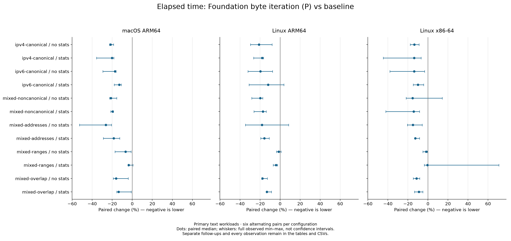
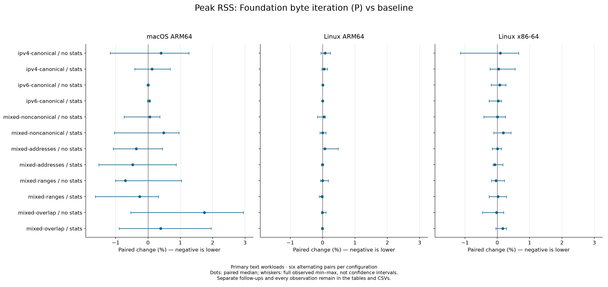

# Foundation-only byte-iteration experiment

Baseline: `9fe30dde3fd5ad50944064f912fad8c19cfcec62`. Prototype branch: `perf/foundation-byte-iteration`.
Experiment: `cidrmerge-foundation-byte-iteration-20261117T154127Z`, preserved under `~/Downloads` on the Mac and swift-dev.

This completed, uncommitted prototype changes one loop in `TextInputLoader.consumeChunk`. It retains Foundation's reads and error handling. The eight locked dependency revisions, Swift 6.2 compiler floor, public interfaces, parser, normalization statistics, pending-line storage, Searchbot path, and output contracts are unchanged.

## What this isolates

After the existing `FileHandle.read(upToCount:)` returns a nonempty `Data`, P borrows its bytes with `try data.withUnsafeBytes { (bytes: UnsafeRawBufferPointer) in ... }` and executes the original byte-processing loop. The pointer never escapes the synchronous closure. FileHandle ownership, EOF behavior, read errors, and the enclosing autorelease boundary are unchanged.

Foundation still creates a `Data` for each read. This is a byte-iteration control, not reusable read storage or a FoundationEssentials migration. It adds no POSIX reads, SystemPackage imports, or error adapters. The existing in-memory Data loader remains unchanged.

## The quoted million-entry workload

This case contains one million ordered disjoint IPv4 /32 networks, raw CIDR output, and statistics disabled. Values below are from fresh matched B/P runs with Swift 6.4.2. Lower is better; percentages are medians of paired percentage changes, not percentages calculated from the two absolute medians.

| Platform | Baseline elapsed median | Candidate elapsed median | Paired median change | Six-pair observed spread |
|---|---:|---:|---:|---:|
| macOS ARM64 | 202.789 ms | 158.789 ms | -21.72% | -22.81% to -18.58% |
| Linux ARM64 | 259.992 ms | 208.293 ms | -21.16% | -29.54% to -8.02% |
| Linux x86-64 | 683.670 ms | 590.540 ms | -13.54% | -17.76% to -8.81% |

The earlier [archived R3 experiment](https://github.com/RouteObjects/cidrmerge/blob/eeca600fa34c5c88e281d19a92d694c3142cbdb7/Benchmarks/Results/2026-11-17-essentials-system/RESULTS.md) reported 199.269 to 149.297 ms on the Mac, with a paired median change of -24.594%. That is historical context, not a matched P-versus-R3 comparison. The current experiment demonstrates a substantial iteration-path gain while retaining per-read Data creation. It does not measure allocation counts or isolate the residual contribution of reusable storage.

## Broader results

These ranges span the paired medians of the twelve text-file configurations; they are not individual-sample ranges.

| Platform | Text elapsed median changes | Text peak-RSS median changes |
|---|---:|---:|
| macOS ARM64 | -26.31% to -3.60% | -0.70% to +1.75% |
| Linux ARM64 | -21.16% to -1.44% | -0.02% to +0.07% |
| Linux x86-64 | -15.33% to -0.56% | -0.08% to +0.18% |

Ordered address/prefix workloads provide the clearest throughput evidence. Small or noisy changes, including some range-derived workloads, remain inconclusive. The four Searchbot file configurations are controls: they bypass the changed reader, and small observed changes do not establish a JSON speedup. Startup observations use warm caches, have wide spreads, and do not establish a general launch-speed improvement.

No configuration shows an elapsed-time or peak-RSS median regression above 5% in both its primary and prescribed follow-up phase. Individual regressions and wide spreads remain visible in the detailed tables and pair records.

See [MEASUREMENTS.md](MEASUREMENTS.md) for every configuration and phase's elapsed, CPU, and peak-RSS medians and spreads; [REGRESSIONS.md](REGRESSIONS.md) for triggered follow-ups; and [summaries.csv](summaries.csv) / [pairs.csv](pairs.csv) for machine-readable records. Primary and follow-up phases are never pooled, and no outliers are discarded.

## Correctness and qualification

| Platform / compiler | Baseline Debug / Release | Candidate Debug / Release | CLI differential | Expanded I/O |
|---|---:|---:|---:|---:|
| macOS ARM64 / Swift 6.4.2 | 85 / 85 | 85 / 85 | 254 | 84 |
| Linux ARM64 / Swift 6.4.2 | 85 / 85 | 85 / 85 | 254 | 86 |
| Linux x86-64 / Swift 6.4.2 | 85 / 85 | 85 / 85 | 254 | 86 |
| Linux ARM64 / Swift 6.2.4 floor | Not repeated | 85 / 85 | Not repeated | Not repeated |

Every listed suite and differential case passed. Each full suite comprises 7 Core and 78 CLI tests. No implementation-mirroring tests were added. The existing tests and external differential harness cover raw/JSON output, exact diagnostics and exit status, statistics, checksums, fail-atomic output, empty/repeated sources, BOM/CRLF, split Unicode and malformed UTF-8, long lines, chunk boundaries, EOF, fragmented input, and real read failures.

Candidate formatting, content audit, documentation, external Core consumer, and CLI smoke checks passed on all three platforms. Core symbol graphs were validated on Linux, and the DocC archive was also built on macOS. Ordinary Release executables were frozen before test builds. Source and binary identities were independently rechecked after qualification and timing.

## Binary and runtime scope

| Platform | Ordinary bytes, B / P | Stripped ordinary bytes, B / P | Direct dependencies |
|---|---:|---:|---|
| macOS ARM64 | 2,444,920 / 2,444,680 | 1,290,512 / 1,290,272 | Unchanged |
| Linux ARM64 | 17,304,928 / 17,306,240 | 3,322,808 / 3,322,808 | Unchanged |
| Linux x86-64 | 17,706,856 / 17,708,176 | 3,721,800 / 3,721,800 | Unchanged |

These are ordinary Release artifacts and separately stripped copies, not a static Linux shipping-build comparison. Full Foundation remains in the CLI runtime closure. The earlier FoundationEssentials prototype's Linux binary-size and runtime-library reductions do not apply here. Library-file sizes are not resident-memory measurements.

## Measurement protocol

| Platform | Machine and OS | Toolchain |
|---|---|---|
| macOS ARM64 | Apple M1 Max, 10 cores, 64 GiB; macOS 27.2.1 (26B131) | Xcode 27.2 (27B52), Apple Swift 6.4.2 |
| Linux ARM64 | Native OrbStack on the same M1 Max; 10 CPUs visible, about 16 GiB; Ubuntu 24.04.5, kernel 7.2.12-orbstack | Swift 6.4.2 release; separate Swift 6.2.4 floor checks |
| Linux x86-64 | swift-dev: Xeon E5520 at 2.27 GHz, 4 CPUs visible, 8 GiB reported RAM; Ubuntu 24.04.5, kernel 6.14.8-2-pve | Swift 6.4.2 release |

| Group per platform | Configurations | Pairs each | Measured executions | Excluded warmups |
|---|---:|---:|---:|---:|
| Six text and two Searchbot file corpora, statistics off/on | 16 | 6 | 192 | 32 |
| Text stdin: canonical IPv4/no statistics; noncanonical mixed/with statistics | 2 | 6 | 24 | 4 |
| Version, empty stdin, 100 mixed entries, 10,000 mixed entries | 4 | 20 | 160 | 8 |
| Primary total | 22 | — | 376 | 44 |

| Platform | Primary measured / warmups | Follow-up measured / warmups | Total measured / warmups |
|---|---:|---:|---:|
| macOS ARM64 | 376 / 44 | 172 / 10 | 548 / 54 |
| Linux ARM64 | 376 / 44 | 220 / 18 | 596 / 62 |
| Linux x86-64 | 376 / 44 | 48 / 8 | 424 / 52 |

Overall: **1,568 measured executions and 168 excluded warmups**. Each primary configuration has one excluded warmup per variant, alternating baseline/candidate pairs, and rotating case order. An individual primary paired elapsed-time or RSS increase above 5% triggers one separate fixed-size follow-up of that configuration. Follow-ups retain the same pair count and receive their own warmups. A new outlier in a follow-up remains reported without recursively scheduling further phases.

Every timed observation verifies complete stdout and stderr against hash-verified independent coverage/statistics references. macOS uses native `/usr/bin/time -p -l` CPU/RSS accounting and wall-clock elapsed time. Linux uses wall-clock elapsed time and wait4 resource accounting. Throughput and stdin use frozen ordinary binaries; startup uses their separately stripped copies.

macOS and native ARM64 OrbStack timing ran separately, with builds, tests, profiling, bulk transfers, and independent audits outside their timing windows. swift-dev ran independently on its existing guest allocation. Disk remained above the 3-GiB measurement minimum. Historical experiments were not deleted; only the new swift-dev memory-backed build scratch was removed after its required artifacts were preserved and hash-verified.

## Limits and preserved failures

These are warm-cache, within-platform comparisons on the recorded machines, not cross-hardware rankings or cold-launch deployment measurements. macOS CPU accounting has 0.01-second resolution, so tiny-call CPU percentages are not interpreted. Linux fork/exec resource accounting can inherit a parent-process peak-RSS floor for small commands; startup RSS therefore does not isolate application-only memory. The million-entry cases' reported peaks exceed the tiny-command controls, but this does not isolate application-only RSS. No floor is subtracted from the observations.

The Mac build driver initially expected one 85-test summary instead of the separate 7-test and 78-test summaries. Its failure is retained; the successful baseline Debug process was independently verified, and only the remaining suites ran afterward. Initial Mac environment/harness controls lacked sandbox access to native counters; those failures remain preserved, with fresh successful attempts before timing. A metadata aggregation assertion was corrected before its authoritative receipt was written. ARM preserved an unsupported process-inventory column probe and its successful replacement. swift-dev preserved a dependency-seed setup failure, then relocated only copied Git alternate-object metadata and reverified all eight clean pinned checkouts before building. Post-timing transfer setup failures were also preserved and corrected before final receipt verification. None of these setup, qualification, or transfer recoveries changes a product timing observation or the candidate source.

The pointer's lifetime is bounded by the closure. The pending line, parsed ranges, Searchbot document, summarized networks, and whole-output Data may still grow with input/output size. This experiment does not claim zero allocation, bounded total memory, or a general Unicode/JSON speedup.

## Reproduction and preservation

See [REPRODUCING.md](REPRODUCING.md) and [evidence-export.json](evidence-export.json). The frozen patch is `control/P.patch` under the experiment root; [candidate-patch.json](candidate-patch.json) contains its exact UTF-8 text and SHA-256. Original sources, binary/runtime snapshots, fixtures, harnesses, logs, raw output, and every failed control remain under the new Downloads experiment. Public evidence copies redact local paths without altering measurement values; the export manifest records both original and exported hashes. CSV copies use LF line endings, with unchanged cells and both hashes recorded in [format-export.json](format-export.json).

The archived `perf/essentials-system-io` branch and unrelated working files remain preserved. This prototype is left uncommitted for review; no push, PR, merge, tag, or release is included.
